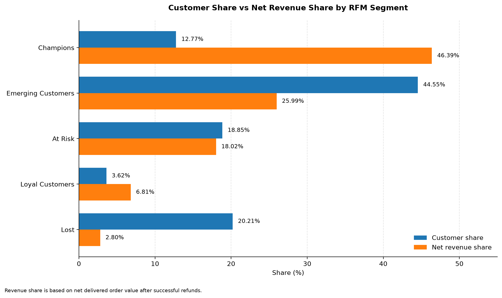

# RFM Customer Segmentation

**Author:** Neharika Mandhan

## 1. Project Overview

An end-to-end customer segmentation project using Recency, Frequency and Monetary (RFM) analysis to understand purchasing behaviour, identify high-value customers, and uncover opportunities for customer retention and revenue growth.

Using PostgreSQL, Python and pandas, I analysed 19,979 delivered orders from a dataset of 10,000 customers. The analysis identified 6,052 customers with at least one delivered order during the observation period of March 16–June 14, 2026.

Customer spending is calculated as delivered order value less successful refunds, providing a net monetary measure.

## 2. Business Question

How can customer purchasing behaviour be used to identify valuable customer groups, understand retention risks, and develop targeted marketing strategies?

## 3. Analytical Approach

The project combines SQL-based data extraction and reconciliation with Python-based data exploration, feature engineering and customer segmentation.

RFM features were calculated using delivered orders only:

- **Recency:** Days since the customer's most recent delivered purchase, measured against June 15, 2026.
- **Frequency:** Number of delivered orders during the observation period.
- **Monetary:** Total delivered order value less successful refunds.

Customers were scored and assigned to five actionable segments using RFM scores and business rules.

## 4. Key Findings

1. **High revenue concentration:** Champions represent 12.77% of customers (773) but contribute 46.39% of net revenue.
2. **Large growth opportunity:** Emerging Customers represent 44.55% of customers (2,696) and 25.99% of revenue. Within this segment, 54.12% are one-time buyers.
3. **Meaningful retention opportunity:** At Risk customers account for 18.85% of customers (1,141) and contribute 18.02% of net revenue, despite an average recency of 67.28 days.

These findings suggest that customer retention and repeat-purchase strategies should be tailored to each segment rather than applied uniformly.

## 5. Key Visualization

The chart below compares each customer segment's share of the customer base with its contribution to net revenue.



## 6. Tools and Technologies

- **Database:** PostgreSQL
- **Programming:** Python
- **Data analysis:** pandas, NumPy
- **Database connectivity:** SQLAlchemy, psycopg2
- **Development environment:** Jupyter Notebook, VS Code
- **Version control:** Git and GitHub

## 7. Project Structure

```text
rfm-customer-segmentation/
│
├── figures/
│   └── rfm_segment_share_comparison.png
│
├── findings/
│   ├── 00_executive_summary.md
│   ├── 01_customer_overview.md
│   ├── 02_rfm_distributions.md
│   └── 03_segment_definitions.md
│
├── notebooks/
│   ├── 01_exploration.ipynb
│   ├── 02_rfm_features.ipynb
│   └── 03_rfm_segments.ipynb
│
├── sql/
│   ├── 01_schema_inspection.sql
│   ├── 02_order_status_analysis.sql
│   ├── 03_refund_analysis.sql
│   └── 04_revenue_analysis.sql
│
├── src/
│   └── db.py
│
├── .env.example
├── .gitignore
├── README.md
└── requirements.txt
```

## 8. How to Reproduce

### Prerequisites

- Python 3.13
- PostgreSQL database (Neon or another PostgreSQL-compatible provider)
- Git

### Setup

1. Clone the repository:

   ```bash
   git clone <https://github.com/neharika/rfm-customer-segmentation>
   cd rfm-customer-segmentation
   ```

2. Create and activate a virtual environment:

   ```bash
   python -m venv .venv
   source .venv/bin/activate
   ```

3. Install dependencies:

   ```bash
   python -m pip install -r requirements.txt
   ```

4. Configure database credentials.

   Copy `.env.example` to `.env`:

   ```bash
   cp .env.example .env
   ```

   Add your PostgreSQL connection details to `.env`.

5. Ensure access to a PostgreSQL database containing the required project tables and data.

6. Run the SQL scripts in the `sql/` directory for schema inspection, order-status analysis, refund analysis and revenue analysis.

7. Open Jupyter Notebook and execute the notebooks in numerical order:

   ```bash
   jupyter notebook
   ```

**Database and data availability:** This project was developed using an existing Neon-hosted PostgreSQL database. The required tables and source data were already available when the project connected to the database. Database credentials and the original dataset are not included in this repository. Reproducing the analysis requires access to a PostgreSQL database containing the required tables and data.

## 9. What I Would Do Next

A useful next step would be to evaluate repeat-purchase conversion among Emerging Customers. By tracking whether one-time buyers make a second purchase within a defined period, the business could measure the effectiveness of targeted recommendations and incentives, and identify which interventions produce the greatest improvement in repeat purchasing.

## 10. Detailed Findings

- [Executive Summary](findings/00_executive_summary.md)
- [Customer Overview](findings/01_customer_overview.md)
- [RFM Distributions](findings/02_rfm_distributions.md)
- [Customer Segment Definitions](findings/03_segment_definitions.md)